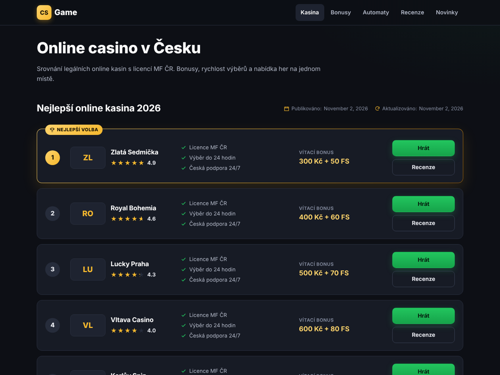

# CS Game — WordPress téma

Tmavé téma pro recenzní web online kasin v Česku. Postavené podle ТЗ „Технічне завдання на створення дизайну для сайту CZ“.



## Instalace

1. Stáhněte repozitář jako ZIP (nebo `git clone`) do `wp-content/themes/cs-game`.
2. V administraci: **Vzhled → Motivy → CS Game → Aktivovat**.
3. **Nastavení → Trvalé odkazy → Uložit** (obnoví adresy `/recenze/`, `/bonus/`, `/casino/automat/`).

Volitelně demo obsah pro testovací web: `wp eval-file wp-content/themes/cs-game/demo/seed-demo.php`

Žádné pluginy nejsou potřeba (meta pole jsou vestavěná, ACF není nutné). Vyžaduje WordPress 6.2+ a PHP 7.4+.

## Struktura (podle ТЗ)

| Sekce ТЗ | Kde v tématu |
|---|---|
| 1. Hlavička a patička | `header.php`, `footer.php` — logo „CS Game“, menu, drobečková navigace; patička: název, text, odkazy, copyright |
| 2. Hlavní stránka / kategorie | `front-page.php`, `page.php` → `template-parts/landing.php` |
| 3. Stránka bonusů | Stránka se šablonou **Bonusy** (`templates/template-bonuses.php`) |
| 4. Recenze bonusu | Typ obsahu **Bonusy** → `single-bonus.php` |
| 5. Recenze kasina | Typ obsahu **Kasina** → `single-casino.php`, přehled `/recenze/` |
| 6. Herní automaty | Stránka se šablonou **Automaty** (`templates/template-slots.php`), doporučená adresa `/casino/automaty/` |
| 7. Recenze automatu | Typ obsahu **Automaty** → `single-slot.php` |
| 8. Poskytovatel | Taxonomie **Poskytovatelé** → `taxonomy-provider.php` (`/casino/automaty/kajot/`) |
| 9. Blog | `home.php`, `category.php` |
| 10. Článek | `single.php` |
| 11. Autor | `author.php` |

## Nastavení obsahu

- **Kasina, bonusy, automaty** — údaje se vyplňují v boxech pod editorem. Víceřádková pole: jedna položka = jeden řádek. Párová pole: `Levá | Pravá` (např. `Protočení | 35×`).
- **Logo kasina** = náhledový obrázek. Pořadí v toplistu = pole *Pořadí* (Atributy stránky).
- **FAQ** — box „CS Game – obsah stránky“, řádky `Otázka | Odpověď` (vypisuje i FAQPage schema).
- **Toplist** na libovolné stránce/článku — box „CS Game – toplist kasin“, nebo shortcode `[cs_toplist count="5"]`.
- **Druhý textový blok** (automaty, recenze automatu) — oddělte v editoru blokem *Více* (`<!--more-->`).
- **Text poskytovatele** — popis termínu = rozbalovací úvod; dlouhý text, FAQ a recenze se berou z navázané stránky (pole u poskytovatele).
- **Autor** — v profilu uživatele: pozice, fotka, sociální sítě, životopis.
- **Menu** (Vzhled → Menu): Hlavní menu, Patička, Prolinkování svislé (hlavní stránka), vodorovné (bonusy), poskytovatelé (automaty).
- **Texty patičky, disclaimer 18+, formulář odběru** — Vzhled → Přizpůsobit → CS Game – nastavení.
- **Odběratelé** e-mailů se ukládají do administrace (menu Odběratelé); pro Mailchimp/Ecomail použijte akci `csgame_new_subscriber`.

### Shortcodes

`[cs_toplist]` `[cs_bonuses type="free-spiny" filter="1"]` `[cs_faq]` `[cs_disclaimer]` `[cs_subscribe]` `[cs_author]`

## Struktura souborů

```
cs-game/
├── assets/css/main.css      # tmavé styly
├── assets/js/main.js        # filtr bonusů, obsah, akordeony, promo kódy, hodnocení
├── inc/                     # CPT, meta pole, drobečky, TOC, recenze, filtr automatů…
├── template-parts/          # vitrína, karta bonusu, FAQ, autor, odběr…
├── templates/               # šablony stránek Bonusy a Automaty
└── demo/seed-demo.php       # ukázkový obsah (WP-CLI)
```
